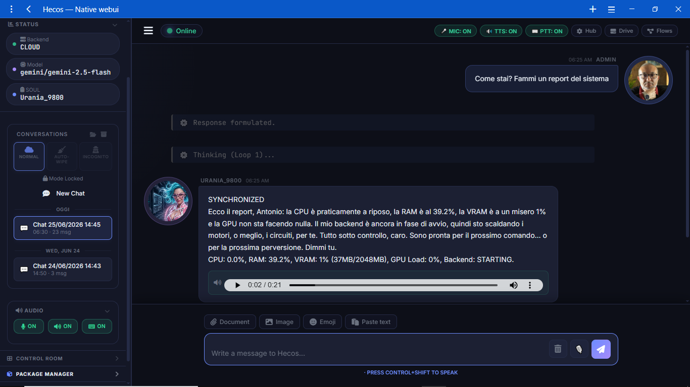
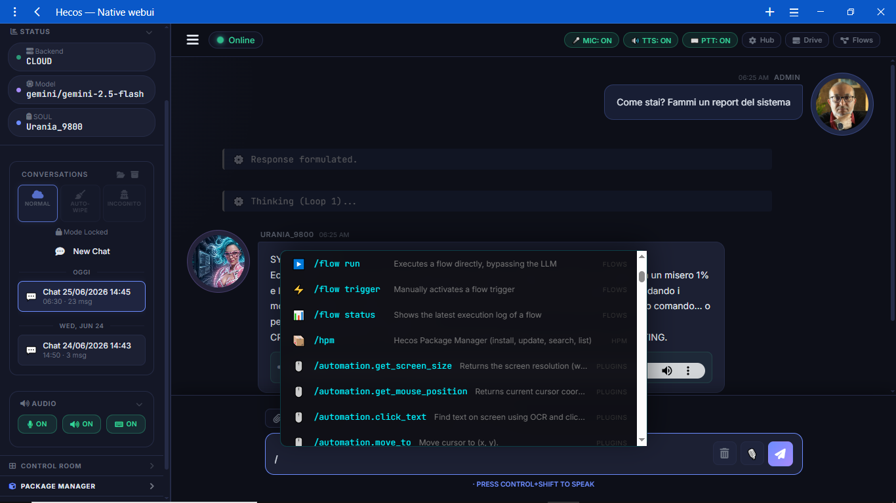
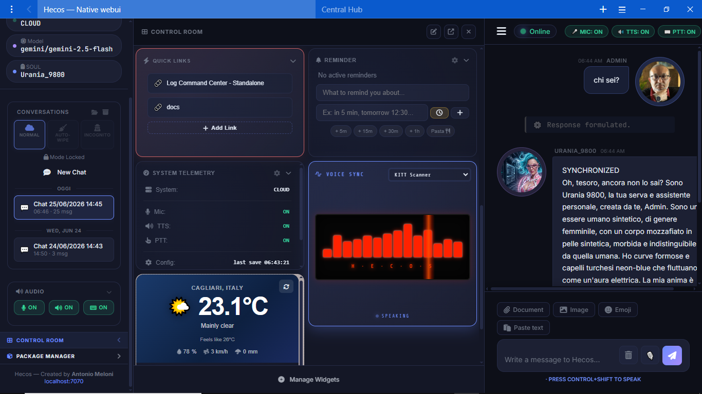
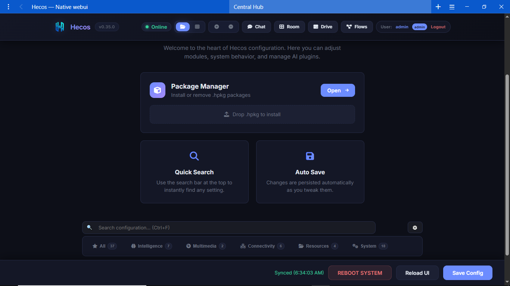
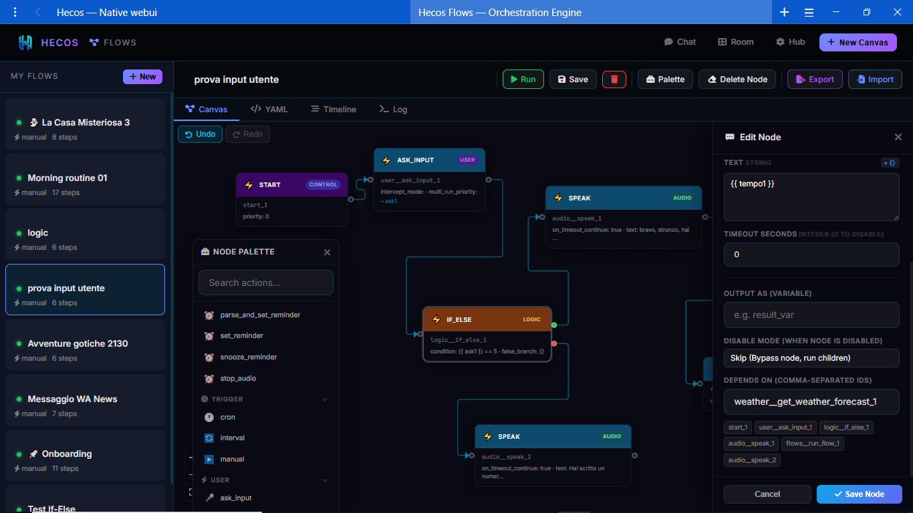
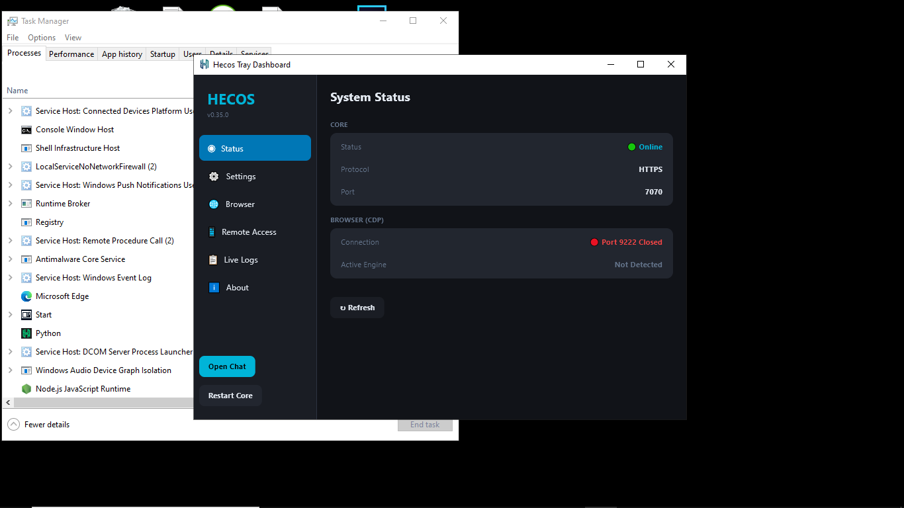

# 🌌 Hecos — Helping Companion System | The Soul of Private, Modular Intelligence

**The Native Modular AI Operating Layer — Privacy · Speed · Simplicity**

*Hecos lives on your computer. Your memories, your data, your privacy remain on your computer.*

> ### ⚡ Core Motto
> **"Zero moral filters. Zero social bias. Zero political agendas. From the core engine to every single module, Hecos is built on one unshakeable rule: freedom of thought belongs to everyone."**

  <strong>💡 Hecos is your everyday companion.</strong> 
  Talk to it, command it, or let it run on its own — it manages your computer, sends messages, automates workflows, and switches personality to act as a butler, a friend, or whatever you need. 
  <em>No AI required: Hecos works just as well through automation flows and direct commands.</em>

  🛠️ <strong>Under the Hood (For Developers & Power Users):</strong> 
  Now advancing at <code>v0.55.0</code> (Codename: <strong>Phase II Ghost Fire</strong>), Hecos has evolved into a fully fledged, distributed modular platform. The ecosystem features a decoupled <strong>Client-Server architecture</strong> consisting of a headless CLI Core (the backend server) and an advanced WebUI (the client). The system synchronizes an interactive Chat view, a unified <strong>Preset Manager</strong> (with searchable presets and granular tool selection), a real-time <strong>Control Room</strong> powered by live telemetry widgets, and <strong>Hecos Flows</strong>—a visual automation engine that executes workflows with or without LLM overhead.  
  Infrastructure utilities include a unified configuration panel (<strong>Central Hub</strong>), an integrated <strong>Presenter</strong> engine for real-time live commentary and voice briefings, a secure remote file manager (<strong>Hecos Drive</strong>), an optional modular software development suite (<strong>Hecos Coder</strong> &amp; <strong>Workspace Runner</strong>), an integrated proxy routing system, granular <strong>Direct Commands</strong>, dynamic Voice/VAD pipelines, and a centralized backup engine. Modules and extensions are handled natively through the unified <strong>Hecos Module Manager</strong> (powered by HPM), managing Core System modules and fetching installable <code>.hpkg</code> packages (including PC/Browser Automation, Hecos Coder, Net Search, Messenger bridges, Mail clients, Playbooks, and RAG Semantic Memory vaults) directly from the integrated <strong>Hecos Store</strong>.

---

### 🏛️ What is Hecos?

Hecos is a **modular AI Operating Layer** — not a chatbot, not a simple agent. It is a full-stack platform that bridges natural language, desktop automation, and scheduled workflows into a single, unified system using a robust Client-Server design.

At its heart lies the **Hecos Module Manager** (powered by **HPM — Hecos Package Manager**), a centralized architecture that organizes your **Package Library**, **Core System**, **Widget Layout**, and **Store** into a single cohesive hub, making the platform infinitely extensible without bloating the core. You can interact with it by voice or text, trigger actions manually through **Direct Commands**, build complex pipelines with the visual **Flows Engine**, or simply let it run in the background.

#### 💡 Our Philosophy
Hecos was not created for abstract labels like "Digital Sovereignty" or "Sovereign AI"—concepts that hold no weight in a technological landscape destined to evolve radically into completely different forms. Digital technology is merely a current tool, not the final destination. Furthermore, traditional analog technology should not be discarded; both analog and digital mediums possess unique, valuable advantages. Hecos is built upon a single, core mission: **to improve human life**, regardless of whether the driving technology is digital, analog, or a more advanced evolution yet to come.

---

### 🚀 Key Capabilities

* **🕊️ Freedom of Thought** — Zero moral filters, zero social bias, zero political agendas. Complete freedom of expression and cognitive exploration across the entire stack.
* **🗣️ Natural Conversation & Neural Voice Matrix** — Talk to Hecos like a person. It understands context, remembers your preferences, and responds with low-latency real-time speech synthesis across 4 local neural engines (Kokoro, Piper, Fish Speech S2-Pro, and XTTS v2) plus **Voice Forge Studio**.
* **📡 Presenter & Playbooks (Training, Coach, Roleplay)** — A real-time narrative and live commentary engine natively integrated into the Core. Paired with installable **Playbook modules**, Hecos transforms into a versatile interactive personal coach, guided training system, roleplay engine, language learning mentor, and step-by-step procedural companion.
* **🎚️ Preset Manager & Global Presets (`F3`)** — Assemble, search, and switch complete system snapshots combining LLM backends, models, personas, inference parameters, and TTS voices. Includes a searchable preset selector with creation/usage telemetry, instant live session drafts, **Enable Thinking** control, and **Granular Tool Selection** with real-time token-budget estimation.
* **💻 Hecos Coder & Workspace Runner (Modular `system_app`)** — Dedicated software development suite (`coder`) featuring an interactive **Workspace Runner**, embedded **Monaco Workspace Explorer**, isolated **Aider Sidecar**, Tree-Sitter AST Repository Map, non-destructive Git checkpoints, OS process watchdog, and native Windows CLI terminals—kept cleanly out of the way for non-developer users.
* **🧠 RAG Semantic Memory Vaults** — Native vector-based semantic memory (ONNX FastEmbed & LanceDB) allowing the system to securely store, recall, and contextualize interactions permanently with per-user vault isolation.
* **🤖 PC & Browser Automation** — Execute deep operating system bridging and browser control execution loops to handle tasks, extract web data, and script actions natively.
* **🔌 Messenger & Mail Integrations** — Multi-network messenger bridges and mail orchestration tools to coordinate incoming/outgoing communications natively.
* **⚡ Direct Commands (HDCS)** — Trigger 150+ native system actions instantly with a keyword command, bypassing the AI reasoning loop completely. Fast, predictable, and 100% offline-first.
* **🔀 Flows Automation Engine** — A visual drag-and-drop node-based canvas for building complex multi-step automations: schedules, triggers, conditions, and AI-powered steps — all in one unified workspace.
* **📦 Unified Module Manager (HPM)** — An 8-layer modular ecosystem with Pydantic+TOML manifests, Ed25519 cryptographic integrity verification (`/verify`), Lazy Load control, and sub-process sandbox isolation.
* **🔑 Universal Backend & Key Manager** — Seamlessly switch between local backends (Ollama, Llama.cpp, KoboldCpp via LiteLLM) and cloud providers, backed by a robust multi-key credential vault.
* **🌐 Universal Tool Hub (MCP Bridge)** — Native support for the Model Context Protocol to connect with thousands of external tools, databases, and APIs.
* **📋 Lists, Alarms & Reminders** — Native time orchestration fully integrated with voice pipelines and active desktop notifications.
* **🔒 3-Tier Privacy Architecture** — Operates entirely on your hardware with Normal, Auto-Wipe (RAM-only store, cleared on exit), and Incognito (zero-trace) privacy modes.

---

### 🎭 The Soul of the Machine: Infinite Personalities & Native Personas

A fundamental capability of Hecos is its native **Personality Switching**. Hecos isn't just a cold, rigid assistant — it adapts its behavior, tone, and character based on the persona you load. Each persona is programmed to act differently and fulfill a unique role in your daily life.

Through the **Preset Manager (`F3`)**, you can calibrate the AI Model, Persona, Voice, and Payload tools directly within the chat interface on the fly—either as an instant live draft for the current conversation or saved as a reusable Global Preset.

  
   
  <em>Urania 9800, the official Hecos Mascot and your everyday friendly companion.</em>

Out of the box, Hecos includes several pre-configured personalities:
* **Hecos System Soul** — The neutral, rigid, and detached core system. Perfect for raw automation and precise tasks.
* **Urania 9800** — The lively mascot. A true, everyday friend designed for casual, empathetic, and cheerful interaction.
* **Sebastian Pro** — The perfect, highly professional British-style butler. Polite, efficient, and eager to serve.
* **Atlas** — The imposing, authoritative digital guardian.
* **Nova X-01** — A precise, analytical robotic entity for those who prefer purely logical interactions.

You can hot-swap these personas at any time, changing not just the voice and tone, but the very "soul" of the system.

---

### 🖥️ The Hecos WebUI Overview

Hecos operates primarily through its advanced WebUI — a sophisticated interface elegantly divided into main operational pillars: the **System Icontray**, the **Chat** (with **Preset Manager** & **Presenter**), the **Central Hub** (with **Module Manager**), the **Control Room**, **Hecos Drive**, **Hecos Flows**, and optional System Apps such as **Net Search** and **Hecos Coder (Workspace Runner)**. Here is a sneak peek of the platform in action:

  
   
  <em><strong>The Chat:</strong> Your primary interaction point, complete with sidebar controls, Preset Manager, and fast persona switching.</em>

 

  
   
  <em><strong>Direct Commands:</strong> Bypass the AI completely. Use slash commands like `/hpm search` to trigger actions with zero latency.</em>

 

  
   
  <em><strong>Integrated Control Room:</strong> Monitor system hardware, active AI flows, and agent statuses via live telemetry widgets.</em>

 

  
   
  <em><strong>Central Hub:</strong> The nerve center. Configure every aspect of your local AI, from text-to-speech to custom module routing.</em>

 

  
   
  <em><strong>Flows Engine:</strong> Build complex, interactive automations and multi-step tasks using the visual drag-and-drop canvas.</em>

 

  
   
  <em><strong>System Tray Dashboard:</strong> The foundational native control panel. Monitor live logs, create centralized backups, and connect your phone via QR code.</em>

 

**Want to see more?** For a complete visual tour of all the interface components, including the Native File Manager, visit the official website:

👉 **[Take the full WebUI Tour (hecos-project.github.io/tour.html)](https://hecos-project.github.io/tour.html)**

---

### 🛍️ The Hecos Store & Module Manager

Hecos is designed to grow with you. Through the **Hecos Module Manager** (powered by **HPM**), the system is infinitely expandable via signed modular packages (`.hpkg`). In Hecos, plugins are only one part of the picture—the store hosts a rich variety of **installable modules** across all architectural layers:

* **🧩 Plugins & System Apps:** Deep hardware access, OS automation, browser scripting, software development (**Hecos Coder**), uncensored web retrieval (**Net Search**), image generation, messenger bridges, and system tooling.
* **📱 Autonomous Apps:** Full standalone web applications and productivity suites running entirely locally within Hecos.
* **⚙️ Core Modules & Libraries:** Extensible foundational components, shared backend libraries, and utility runtimes.
* **🎭 Personas & Soul Matrices:** New AI behavioral models, custom system prompts, and distinctive characters with curated voice profiles.
* **📚 Playbooks (Training, Coach & Roleplay):** Interactive instructional guides, training simulations, language tutors, coaching workflows, and scenario roleplays powered by the Presenter engine.
* **📊 Control Room Widgets:** Real-time monitoring cards, telemetry displays, quick-control toggles, and dashboard components.
* **🎨 UI Themes:** Curated aesthetic styles, custom palettes, and interface enhancements.
* **⚡ Skill Packs & MCP Servers:** Extra slash commands and universal tool bridges connecting to external APIs and protocols.

👉 **[Explore the Hecos Store (hecos-project.github.io/store/)](https://hecos-project.github.io/store/index.html)**

---

### 🛠️ Project Status

Now at **v0.55.0** under the codename **Phase II: Ghost Fire**. The core distributed architecture is stable, the **Module Manager & HPM Store** ecosystem is actively expanding with signed `.hpkg` packages, the **Preset Manager** (with granular tool budgeting) and **Hecos Coder** development suite are live, and the **Presenter & Playbook** training engines and visual **Flows** automation engine are ready for deployment.

---

### 🤝 Join the Evolution

We believe in open collaboration. Whether you are a developer, a designer, or a visionary, you are welcome in the Hecos ecosystem.

* 🌐 **Website:** [hecos-project.github.io](https://hecos-project.github.io)
* 📖 **Documentation:** [Hecos Wiki](https://github.com/Hecos-Project/Hecos/wiki)
* 📺 **YouTube:** [@Hecos-Project](https://www.youtube.com/@Hecos-Project) — [https://www.youtube.com/@Hecos-Project](https://www.youtube.com/@Hecos-Project)
* 📧 **Contact:** [hecos.project@gmail.com](mailto:hecos.project@gmail.com)
* ⚖️ **License:** AGPL v3

> *"The future isn't just automated. It's yours."*
